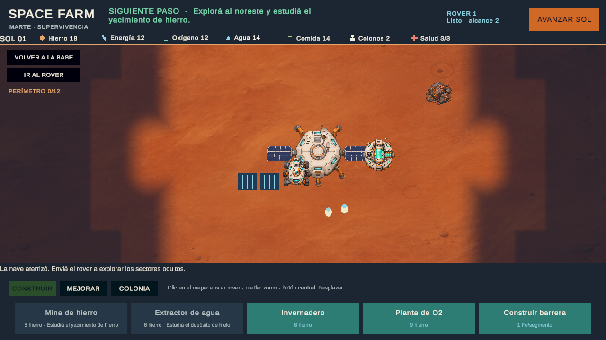
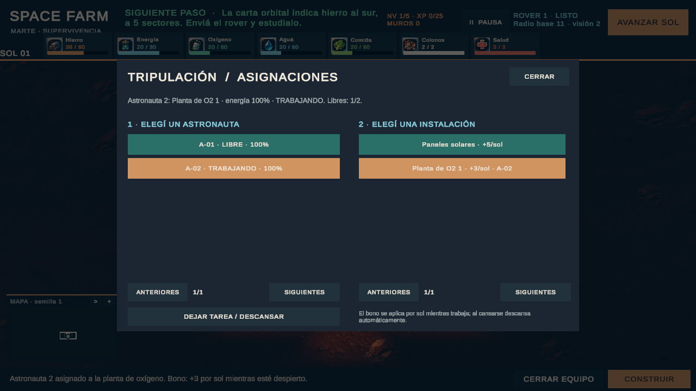

# Space Farm

**Estrategia, supervivencia y aprendizaje en una colonia marciana.** Explora, construye y mantén con vida a tu tripulación mientras descubres cómo dependen unos de otros el agua, el oxígeno, los alimentos y la energía.

| Recurso | Enlace |
| --- | --- |
| **Jugar en el navegador** | [Space Farm en itch.io](https://stellarmindsofumes.itch.io/space-farm) |
| **Ver el juego** | [Video de demostración en YouTube](https://youtu.be/G_yiQyKxtbU) |
| **Ver la presentación** | [Diapositivas en Google Drive](https://drive.google.com/drive/folders/1T_TebLnmfFF1pRxE3aL300mr5Z4tbN8J?usp=sharing) |

## La misión

En *Space Farm* diriges una base en Marte. Cada partida crea un mapa diferente a partir de una semilla: hay cráteres, campos de dunas, depósitos de hierro y hielo, y lugares por descubrir. Puedes repetir una semilla para jugar el mismo mapa o elegir otra para afrontar un nuevo desafío.

El objetivo inicial es **mantener la colonia hasta el sol 7**, construir al menos **una mina** y **un invernadero**, y alcanzar el **nivel 3** de la colonia. Para lograrlo, debes explorar con el rover, producir recursos, ampliar la base y responder a tormentas y averías.

## Qué hace diferente a Space Farm

- **Los recursos tienen una cadena logística.** El hierro, el agua, el oxígeno y los alimentos se almacenan primero donde se obtienen. El rover debe transportarlos hasta un almacén antes de que la colonia pueda usarlos.
- **La supervivencia exige equilibrar sistemas.** Los cultivos necesitan agua y energía; los paneles solares alimentan la base, pero las tormentas reducen su rendimiento. Construir más instalaciones y sumar astronautas también aumenta el consumo.
- **Explorar abre posibilidades.** El mapa comienza oculto. Estudiar yacimientos y puntos de interés permite ampliar la colonia y acceder a nuevas zonas.
- **Cada persona cuenta.** Puedes asignar astronautas a instalaciones para mejorar la producción; necesitan descansar y consumir suministros.
- **Las decisiones tienen consecuencias visibles.** Los edificios se pueden construir, mejorar, mover o reparar. El minimapa, las fichas de instalaciones y los avisos de la colonia ayudan a seguir el estado de la partida.

## Guía rápida para jugar

1. Abre [el juego en itch.io](https://stellarmindsofumes.itch.io/space-farm), elige **Nueva partida** y ponle un nombre.
2. Pulsa **Iniciar expedición** y espera a que aterrice la nave.
3. Haz clic en el terreno o en una señal de recurso para enviar el rover a explorar.
4. Abre **Construir** para colocar instalaciones. Consulta sus fichas para ver costos, producción y requisitos.
5. Vigila las reservas de agua, oxígeno y comida. Usa el rover para recoger recursos y llevarlos al almacén; puedes activar la recolección automática desde **Colonia**.
6. Mejora la base, asigna astronautas y avanza los soles hasta cumplir la misión.

**Controles:** arrastra el mapa para mover la cámara; usa la rueda del ratón para acercar o alejar la vista. También puedes mover la cámara con **WASD** o las flechas. **Escape** cancela una acción activa o abre **Pausa**. Los botones **Volver a la base** e **Ir al rover** te ayudan a orientarte.

El juego está disponible en **español e inglés**. Desde **Configuración** puedes cambiar el idioma y ajustar música y efectos. **Guardar partida** y **Continuar** permiten retomar el progreso en el mismo dispositivo.

## Ciencia y ficción

Space Farm es una **simulación educativa inspirada en investigaciones de la NASA**, con reglas simplificadas para hacer visibles las relaciones entre los sistemas de una colonia. Las fichas dentro del juego explican el principio científico de cada instalación y sus límites. La producción de oxígeno se inspira en el experimento [MOXIE](https://www.nasa.gov/missions/mars-2020-perseverance/perseverance-rover/nasas-oxygen-generating-experiment-moxie-completes-mars-mission/); la planta capaz de sostener una colonia es una proyección ficticia. Las incursiones alienígenas también son ficción.

La propuesta también se apoya en investigaciones de la NASA sobre [hielo subsuperficial en Marte](https://www.nasa.gov/solar-system/planets/mars/nasa-is-locating-ice-on-mars-with-this-new-map/) y [cultivos para misiones espaciales](https://www.nasa.gov/science-research/nasa-plant-researchers-explore-question-of-deep-space-food-crops/). El juego no pretende reproducir con exactitud una misión humana real a Marte.

## Galería

| Exploración | Vida en la colonia |
| --- | --- |
|  |  |

**Desarrollado en Unity 6 para navegador (WebGL).** El mapa procedural, la gestión de recursos, la logística del rover y la progresión de la colonia forman parte de la versión jugable enlazada arriba.
