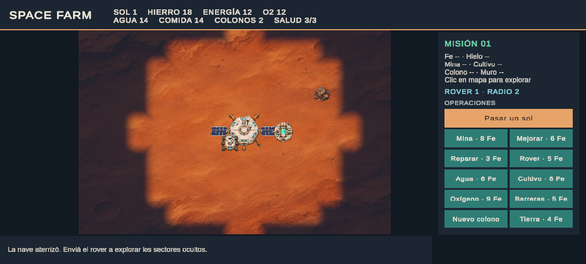

# Space Farm

Prototipo inicial de un juego de estrategia y supervivencia educativa en Marte. El concepto completo está en [SPACE_FARM_CONCEPTO.md](SPACE_FARM_CONCEPTO.md).

## Abrir el proyecto

1. Instalar **Unity 6.6.9f1** con soporte para Web si se quiere generar una versión Web.
2. En Unity Hub, añadir la carpeta `SpaceFarm` de este repositorio como proyecto.
3. Abrir `Assets/Scenes/SpaceFarm.unity` y pulsar **Play**.

## Controles del prototipo

- Clic en terreno: enviá el rover. Clic en una instalación: abrí su ficha con producción nominal, resultado del último sol e insumos. El hierro está al noreste de la nave y el hielo al noroeste.
- Rueda del mouse: zoom. WASD o arrastre con botón central: mover cámara. Los botones **Volver a la base** e **Ir al rover** reubican la vista.
- La mina guarda el hierro extraído (6 Fe en nivel 1, 15 Fe en nivel 2). Seleccionala y pulsá **Recoger**: el rover carga 4 Fe (8 en nivel 2), vuelve al hábitat y allí descarga al inventario.
- **Construir barrera** abre 12 lugares alrededor del núcleo. Cada clic válido coloca una pieza y cobra 1 Fe. **Terminar** o Escape salen del modo. El HUD muestra la cobertura y el hierro disponible.
- La tormenta ocurre en los soles 3 y 4; la incursión, en el sol 5. Con menos de 8 barreras, la mina puede averiarse. La primera victoria requiere mantener la colonia hasta el sol 7 con mina, invernadero, tres colonos y al menos 8 segmentos.
- Los astronautas visibles reflejan la población actual. Los iconos superiores conservan nombres y cifras; la ficha de cada instalación permite entender por qué produjo menos.

La simulación es deliberadamente simplificada. La planta de oxígeno es una extrapolación ficticia inspirada en MOXIE; las criaturas son ciencia ficción.

## Estructura

- `SpaceFarm/Assets/Scripts/SpaceFarmState.cs`: reglas de recursos, edificios y eventos.
- `SpaceFarm/Assets/Scripts/SpaceFarmGame.cs`: mapa, rover, interacción e interfaz.
- `SpaceFarm/Assets/Scripts/SpaceFarmGameWorld.cs`: terreno, barreras, puntos de interés, paneles solares y astronautas.
- `SpaceFarm/Assets/Scripts/SpaceFarmGameHud.cs`: iconos de recursos, navegación y fichas contextuales.
- `SpaceFarm/Assets/Scripts/SpaceFarmPalette.cs`: colores del prototipo.
- `SpaceFarm/Assets/Scenes/SpaceFarm.unity`: escena principal.
- `SpaceFarm/Assets/Resources/Art/`: terreno y sprites originales de este prototipo.

El arte es provisional y se puede sustituir sin cambiar las reglas del juego. Si Unity importa las imágenes como texturas normales en otra máquina, usar **Space Farm → Preparar arte 2D** dentro del editor.

Los directorios `Library`, `Temp`, `Logs` y `UserSettings` del editor se excluyen de Git.
