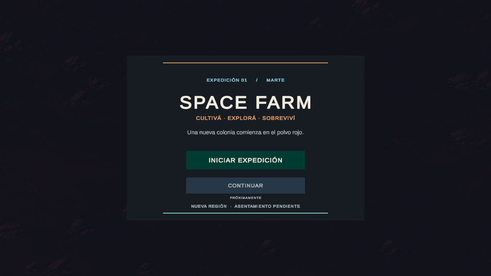

# Space Farm

Prototipo de un juego de estrategia y supervivencia educativa en Marte. El concepto completo está en [SPACE_FARM_CONCEPTO.md](SPACE_FARM_CONCEPTO.md).



## Abrir el proyecto

1. Instalar **Unity 6.6.9f1** con soporte para Web si se quiere generar una versión Web.
2. En Unity Hub, añadir la carpeta `SpaceFarm` de este repositorio como proyecto.
3. Abrir `Assets/Scenes/SpaceFarm.unity` y pulsar **Play**.

Al pulsar **Iniciar expedición**, la nave baja hasta la zona de la base durante unos cinco segundos. Los controles quedan bloqueados hasta que aparecen las instalaciones iniciales. La secuencia vuelve a reproducirse al reiniciar.

## Un Marte distinto en cada partida

Cada partida genera una región de **128×80 sectores** a partir de una **semilla** entera. La misma semilla repite exactamente el mismo terreno, cráteres, yacimientos y puntos de interés; otra semilla los cambia. La semilla se ve en el título del minimapa y en el menú de pausa.

- **Relieve:** llanuras, campos de dunas, zonas rocosas, un cráter grande, varios medianos y pequeños, crestas y un cauce seco. Todo el relieve es visual: el rover puede cruzar cualquier sector, así que ninguna semilla deja un recurso inaccesible.
- **Base:** aterriza cerca del centro, en el terreno más despejado de esa zona. A 5 sectores a la redonda no hay cráteres, yacimientos ni puntos de interés.
- **Yacimientos:** de 7 a 10 de hierro (`Fe-1`, `Fe-2`…) y de 5 a 7 de hielo (`Hielo-1`…), numerados del más cercano al más lejano, más 4 a 6 puntos de interés. Hay al menos un depósito de cada recurso en cada una de las cinco zonas de progreso. La misma semilla reproduce sus posiciones.
- **Niveles y exploración:** el nivel de la colonia sube con XP al estudiar depósitos, descubrir puntos, construir, mejorar y sobrevivir soles. Los niveles 1–4 permiten al rover llegar hasta 11, 24, 39 y 56 sectores desde la base; el nivel 5 abre todo el mapa. La niebla también respeta ese límite. Cada nivel suma dos astronautas y dos plazas al hábitat.
- **Minas sin tope artificial:** se puede construir una mina por cada yacimiento de hierro generado, estudiado, libre y accesible; no hace falta asignar un trabajador para construirla. Cada mina tiene nivel y depósito local propios. El rover lleva 12 unidades entre los cuatro recursos, o 24 después de mejorarlo.
- **Logística física:** oxígeno, agua y comida se acumulan primero en la instalación que los produce; el hierro permanece en el depósito de cada mina. El rover debe ir hasta la fuente, cargar y volver a un almacén. Solo lo descargado pasa a las reservas que consume la colonia. La recolección automática viene activada y prioriza el recurso vital más escaso; también se puede ordenar una fuente desde su ficha.
- **Capacidad compartida:** se permiten hasta cinco almacenes y cada uno añade 120 espacios. Hierro, oxígeno, agua y comida usan la misma capacidad. Las reservas iniciales ocupan 96 de los 120 espacios. Las cargas sobrantes permanecen en el depósito local o en el rover; los pedidos a la Tierra esperan espacio antes de entregar.
- **Mejoras individuales:** cada mina, extractor, invernadero, planta de oxígeno y almacén tiene su propio nivel del 1 al 5. Construir una instalación nueva siempre comienza en nivel 1. Los paneles solares y el rover también tienen mejoras propias. La duración inicial es de 30 segundos; cada nivel posterior duplica el tiempo y añade 2 Fe al costo.
- **Incursión y tormentas:** la incursión del sol 5 reduce pérdidas de comida según los muros cercanos. Una tormenta puede reducir la energía solar y averiar como máximo una instalación por vez; las minas no se deterioran con el tiempo.
- **Ciclo de los soles:** el sol avanza automáticamente cada 2 minutos de juego y el contador se pausa al abrir Pausa. También se puede usar **Avanzar sol** para adelantarlo manualmente.
- **Audio:** la partida incluye música ambiental original sintetizada en tiempo real y una alarma breve cuando una tormenta avería una instalación. En **Pausa → Sonido** se ajustan por separado música y efectos; los niveles quedan guardados en este dispositivo.
- **Cultivos por invernadero:** cada invernadero empieza con trigo (nivel 1, 7 alimentos en 1 sol). Al mejorarlo se desbloquean lechuga (nivel 2, 16 en 2 soles) y maíz (nivel 3, hasta 24 en 3 soles). Se elige el cultivo por instalación; cada sol de crecimiento consume agua y energía, y la falta de insumos detiene el ciclo. La tripulación asignada aumenta la cosecha.

## Controles

- **Cámara:** arrastrar el mapa con el mouse, WASD o flechas. Rueda: zoom. Un arrastre nunca se convierte en orden. **Volver a la base** e **Ir al rover** reubican la vista; **Seguir** acompaña al rover hasta que movés la cámara.
- **Explorar:** clic en el terreno envía el rover por un camino libre dentro del alcance del nivel actual. No cruza muros ni instalaciones. Clic en una señal (`SEÑAL Fe-2`) lo manda a estudiarla.
- **Construcción:** el botón **Construir** abre un catálogo con miniaturas, función, costo y requisitos. Elegí un plano y movelo por el mapa: cian indica posición válida y rojo explica el bloqueo. Un clic sobre un sector válido confirma; Escape, clic derecho o **Cancelar** abandonan el plano sin gastar hierro. También podés arrastrar una tarjeta del catálogo y soltarla sobre el mapa. Hasta cinco invernaderos y cinco plantas de O2 pueden ocupar celdas reveladas y libres; mina y extractor deben ir exactamente sobre el yacimiento estudiado que elijas.
- **Mejoras:** el botón **Mejoras** abre una lista de edificios concretos con nivel siguiente, costo, beneficio y tiempo. Elegir una entrada solo enfoca el edificio. Desde su ficha, el primer clic envía al rover a una celda accesible; cuando llegue, confirmá allí la mejora. No se cobra al mirar el catálogo.
- **Fichas y logística:** clic en un edificio abre su ficha, con depósito local, reservas, carga del rover y capacidad de almacén. Los botones **Recoger** envían el rover desde una instalación. El menú **Colonia** permite activar o pausar la recolección automática; **Enviar rover al almacén** descarga la carga disponible.
- **Editar:** activá **Editar**, seleccioná un muro o una estructura móvil y usá **Mover** para elegir una huella libre. Nivel y trabajador se conservan. Los muros y edificios no pueden cubrirse entre sí, y no pueden ocupar celdas de actores ni bloquear las reglas de acceso. Minas y extractores quedan anclados a sus yacimientos, pero se pueden eliminar cuando no conservan carga. Eliminar exige confirmación y devuelve aproximadamente la mitad del costo base, limitado por el espacio libre; un muro cuesta 1 Fe y su reembolso redondea a 0. No se elimina un almacén si la capacidad restante no alcanza para las reservas.
- **Explorar:** botón **Explorar** cierra los modos de construcción/edición y restaura las órdenes habituales al rover. Construir, mejoras, editar y tripulación son modos separados; Escape cancela primero una operación activa.
- **Fichas educativas:** las fichas explican el principio científico y las simplificaciones de cada sistema. Las fuentes primarias y los límites del modelo están documentados en [`SpaceFarm/REFERENCIAS_EDUCATIVAS.md`](SpaceFarm/REFERENCIAS_EDUCATIVAS.md).
- **Muros:** elegí **Construir muros** en el catálogo y colocalos libremente en celdas reveladas. No hay un máximo fijo. Cada uno cuesta 1 Fe y se une automáticamente con los muros de los cuatro sectores vecinos para formar tramos y esquinas. No se pueden poner sobre instalaciones, el rover u otros muros. Los astronautas no bloquean la construcción. Los muros próximos al hábitat reducen la pérdida de comida durante la incursión.
- **Tripulación:** el botón **Astronautas** abre un panel propio. Elegí una persona y después una instalación construida: mina, extractor, invernadero, planta de O2 o paneles solares. Un trabajador despierto aporta **+3 unidades por sol** a las primeras cuatro instalaciones o **+5 energía por sol** a los paneles. El panel muestra su tarea, energía y descanso; **Dejar tarea** lo libera. Cada instalación admite un astronauta. Quienes se cansan vuelven al dormitorio y descansan automáticamente; durante el descanso no dan bonificación. El movimiento de los astronautas evita edificios, muros, rover y compañeros. Los ciclos de trabajo y descanso duran más para que el cambio de actividad sea visible. Más astronautas consumen más O2, agua y comida por sol.
- **Economía inicial:** la nave trae 36 Fe, 20 energía y 20 de cada recurso vital; esos cuatro recursos materiales ocupan 96 de los 120 espacios del almacén inicial. Los paneles producen 14 energía por sol; cada planta de O2 produce 7 en su depósito local y cada extractor 8 de agua. El rendimiento de comida y su ciclo dependen del cultivo elegido. La colonia consume solo lo que llegó al almacén.
- **Reparaciones:** las fichas muestran el costo y el tiempo. Para una instalación averiada, el rover debe llegar a una celda accesible antes de cobrar e iniciar 30 segundos de reparación; la avería sigue activa hasta el final. Si el rover está averiado, se repara en el taller de la base. Pausar detiene el temporizador.
- **Minimapa:** muestra terreno explorado, niebla, base, rover, yacimientos y puntos ya descubiertos y el recuadro de la cámara. Clic en zona explorada: centra la cámara sin mover al rover. `+`/`-` cambia el tamaño y `<`/`>` lo pasa de esquina; la preferencia se guarda.
- **Pausa y partidas:** Escape o el botón **Pausa** detienen rover, astronautas y temporizadores. **Sonido** permite controlar música ambiental y efectos/alarma, incluso durante la partida. **Guardar partida** escribe un archivo independiente en `Application.persistentDataPath/SpaceFarmSaves`, con versión y reemplazo seguro. En el inicio, **Continuar** lista partidas por nombre, fecha, sol, nivel y semilla; se puede elegir o eliminar cada una. **Nueva partida** pide un nombre no vacío ni duplicado antes de jugar.
- **Pedido a la Tierra:** cuesta 4 Fe y llega tras dos soles con +5 agua y +5 comida. Solo puede haber un pedido pendiente; su llegada se muestra con una nave que aterriza, entrega los suministros y despega. Pausar detiene la animación, y reiniciar elimina la nave de la partida anterior.
- Las tormentas se determinan al avanzar el sol: pueden ocurrir desde el sol 3, su probabilidad aumenta con el nivel de colonia y el paso del tiempo, y como mínimo hay un sol de respiro entre tormentas. Reducen la generación solar; cada tormenta también tiene una probabilidad de averiar una instalación elegida al azar (paneles, dormitorio, invernadero, rover o una mina). Solo puede haber una avería activa a la vez. Repararla cuesta hierro y energía, y devuelve la producción o el movimiento afectados. Las minas ya no se averían solas con el paso del tiempo. La incursión alienígena sigue ocurriendo en el sol 5. La primera victoria requiere llegar al sol 7 con al menos una mina, un invernadero y la colonia en nivel 3.

La simulación es deliberadamente simplificada. La planta de oxígeno es una extrapolación ficticia inspirada en MOXIE; las criaturas son ciencia ficción.

## Estructura

- `SpaceFarmMap.cs`: generador determinista (semilla → terreno, cráteres, base, yacimientos, puntos) y sus reglas de validación. No usa `UnityEngine.Random`.
- `SpaceFarmTerrainPainter.cs`: pinta el mapa en una sola textura con relieve y da los colores del minimapa.
- `SpaceFarmState.cs`: reglas de recursos, yacimientos, posiciones elegidas para edificios, validación de ubicación y eventos.
- `SpaceFarmGame.cs`: ciclo de la partida, cámara, entrada y viajes del rover.
- `SpaceFarmGameConstruction.cs` y `SpaceFarmBuildCardDrag.cs`: plano visual, modos de interacción, confirmación y arrastre desde el catálogo.
- `SpaceFarmGameWorld.cs`: terreno, yacimientos e instalaciones, barreras, paneles y astronautas.
- `SpaceFarmGameFog.cs`: niebla de guerra, que solo recalcula la zona que cambia.
- `SpaceFarmGameHud.cs`: recursos, acciones, navegación y fichas contextuales.
- `SpaceFarmGameCrew.cs`: panel de tripulación y asignación individual a instalaciones.
- `SpaceFarmGameMinimap.cs` y `SpaceFarmMinimapInput.cs`: minimapa.
- `SpaceFarmGamePause.cs`: menú de pausa y reinicios.
- `Assets/Editor/SpaceFarmChecks.cs`: pruebas de reglas y de generación.
- `Assets/Editor/SpaceFarmPlayChecks.cs`: prueba en Play Mode del flujo real y capturas.

Todos los scripts de juego están en `SpaceFarm/Assets/Scripts/`.

## Pruebas

- **Space Farm → Comprobar reglas básicas:** recursos garantizados en cinco zonas para 100 semillas, niveles, alcance, descanso, producción y mejoras de 30 segundos.
- **Space Farm → Probar partida en Play Mode:** juega la escena real (descubrir, construir, producir, recoger, pausar en pleno viaje, minimapa, reinicios) y guarda capturas en `docs/screenshots/`.

Desde la línea de comandos:

```
Unity -batchmode -projectPath SpaceFarm -executeMethod SpaceFarm.Editor.SpaceFarmChecks.Run -quit
Unity -projectPath SpaceFarm -executeMethod SpaceFarm.Editor.SpaceFarmPlayChecks.Run -sfExit
```

El arte de los edificios es provisional y se puede sustituir sin cambiar las reglas. Si Unity importa las imágenes como texturas normales en otra máquina, usar **Space Farm → Preparar arte 2D** dentro del editor.

Los directorios `Library`, `Temp`, `Logs` y `UserSettings` del editor se excluyen de Git.
